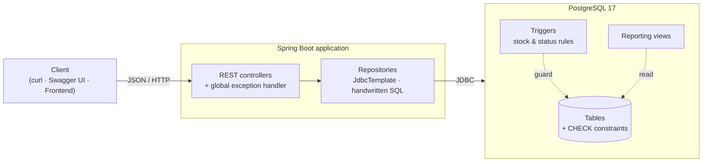
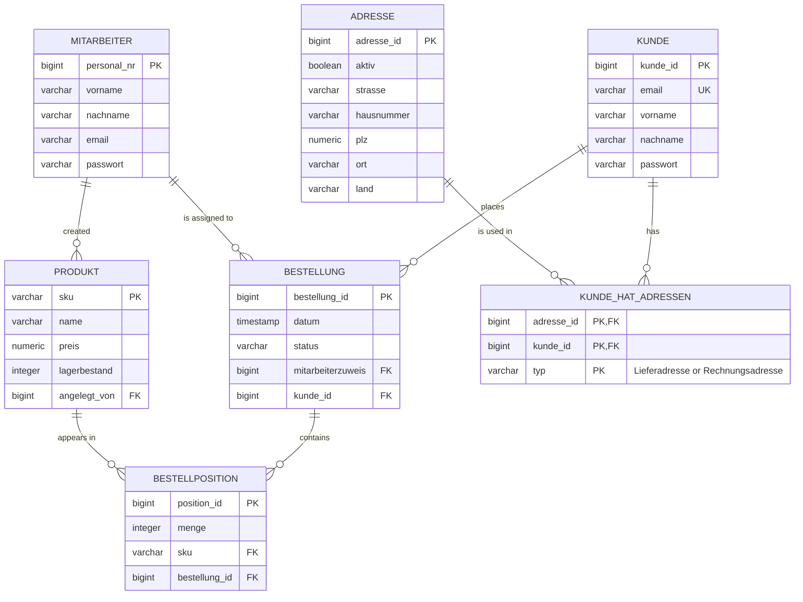
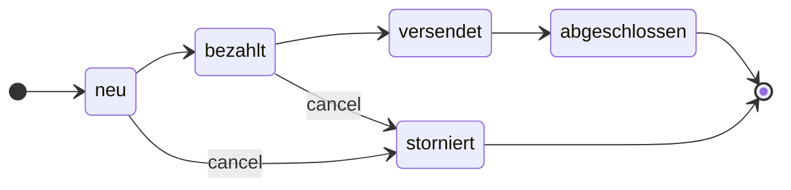

# 🛒 Datenbank-Projekt: Order Management Backend


A REST backend for a small online shop: **customers, addresses, employees, products, orders and order items**. Built with **Spring Boot** and **PostgreSQL**.

This was my final project for the university course **"Datenbanken: Weiterführende Konzepte"** (*Advanced Database Concepts*), winter semester 2025/26. The project's main idea is that **the database protects its own data**. Validation, stock management and order rules live in PostgreSQL as constraints, triggers and views, so the data stays consistent no matter who writes to it: the API, a script or someone typing SQL by hand.

---

## ✨ Highlights

- **A normalized schema of 7 tables** with foreign keys, cascading deletes and a many-to-many link table for addresses.
- **Regex `CHECK` constraints** validate emails, names, street names, house numbers and password strength in the database itself.
- **PL/pgSQL triggers handle stock automatically.** Adding, changing or removing an order item updates the product's stock. Orders that would take stock below zero are rejected.
- **Overselling is blocked under concurrency.** The stock trigger locks the product row (`SELECT … FOR UPDATE`), so two orders placed at the same time can't both take the last item.
- **The order lifecycle is enforced in the database.** An order can only be cancelled while it is `neu` or `bezahlt`. Cancelling it puts all its items back into stock in one set-based `UPDATE`.
- **4 reporting views** with conditional aggregation, `LEFT JOIN`s, `COALESCE` and a `CROSS JOIN` against an `unnest`-ed status list.
- **No ORM.** All SQL is handwritten and parameterized, run through Spring's `JdbcTemplate`. One-to-many joins are turned into nested JSON in a single query with a custom `ResultSetExtractor`, which avoids the N+1 query problem.
- **Clean REST semantics:** `201 Created` with a `Location` header, `204 No Content`, `404 Not Found`. Database constraint violations become `400 Bad Request` instead of a `500` error.
- **Interactive API docs** through springdoc OpenAPI / Swagger UI.
- **One-command database setup** with Docker Compose. The schema and seed data load automatically.

---

## 🧰 Tech Stack

| Layer | Technology |
| --- | --- |
| Language | Java 17 (records for all DTOs) |
| Framework | Spring Boot 3.5 (Web, JDBC, DevTools) |
| Database | PostgreSQL 17 |
| Data access | Spring `JdbcTemplate`, plain SQL |
| API docs | springdoc-openapi 2.8 (Swagger UI) |
| Infrastructure | Docker Compose |
| Build | Maven |

---

## 🏗️ Architecture



The application is split into three layers:

- **Controllers** (`controller/`) handle HTTP: query parameters, status codes and `Location` headers.
- **Repositories** (`repositories/`) hold all SQL and map result sets to Java records.
- **Models** (`model/`) are immutable `record` types for entities, requests, responses and reports.

---

## 🗄️ Data Model



`kunde_hat_adressen` has a composite primary key `(adresse_id, kunde_id, typ)`. This lets a customer have several delivery and billing addresses, and lets one address be both the delivery and the billing address of the same customer.

### Integrity constraints

| Column | Rule (enforced by PostgreSQL) |
| --- | --- |
| `kunde.email` | `UNIQUE`; must contain `@` followed later by a `.` |
| `vorname`, `nachname` | Letters only (including umlauts), 1–32 characters |
| `adresse.strasse` | Starts with a capital letter, then letters only |
| `adresse.hausnummer` | Digits plus an optional lowercase letter (`12`, `7a`) |
| `passwort` | 5–20 characters, with at least one letter, one digit and one special character |
| `produkt.sku` | Letters, digits and hyphens only (`SKU-1001`) |
| `produkt.preis` / `lagerbestand` | Never negative |
| `bestellposition.menge` | Greater than 0 |
| `bestellung.status` | One of `neu`, `bezahlt`, `versendet`, `abgeschlossen`, `storniert` |

All surrogate keys use `GENERATED ALWAYS AS IDENTITY`.

---

## ⚙️ Business Logic in the Database

### Order lifecycle



An order can only be cancelled while it is still `neu` (new) or `bezahlt` (paid). Once it has been shipped (`versendet`), the database rejects the cancellation.

### Triggers

| Trigger | Fires | What it does |
| --- | --- | --- |
| `bestellposition_before_insert` | `BEFORE INSERT` on `bestellposition` | Locks the product row, rejects the item if there isn't enough stock, then reduces the stock |
| `bestellposition_before_update` | `BEFORE UPDATE` on `bestellposition` | Returns the old quantity to stock and takes the new one, even if the product or order changed |
| `bestellposition_before_delete` | `BEFORE DELETE` on `bestellposition` | Puts the item's quantity back into stock |
| `bestellung_before_status_update` | `BEFORE UPDATE OF status` on `bestellung` | Allows cancellation only from `neu` or `bezahlt` |
| `bestellung_after_status_update` | `AFTER UPDATE OF status` on `bestellung` | When an order is cancelled, returns the stock for all its items in one `UPDATE … FROM (SELECT … GROUP BY)` |

The stock triggers skip orders that are already cancelled, so stock is never counted twice.

### Reporting views

| View | Endpoint | Shows |
| --- | --- | --- |
| `v_kunde_summe_anzahl_bestellungen` | `/report/kunde/summe-anzahl-bestellungen` | Number of orders and total order value per customer |
| `v_produkt_verkaufszahlen` | `/report/produkt/verkaufszahlen` | Units sold, revenue and number of orders per product. Only orders past `neu` count; cancelled orders don't |
| `v_mitarbeiter_uebersicht` | `/report/mitarbeiter/uebersicht` | Orders managed and products created per employee |
| `v_mitarbeiter_bestellstatus_uebersicht` | `/report/mitarbeiter/bestellstatus-uebersicht` | Employee × status grid. A `CROSS JOIN` with `unnest(ARRAY[...])` makes every status show up, with `0` instead of a missing row |

---

## 🚀 Getting Started

### Prerequisites

- [Docker](https://www.docker.com/) (with Docker Compose)
- Java 17 or newer
- [Maven](https://maven.apache.org/)

### 1. Start the database

```bash
docker compose up -d
```

This starts PostgreSQL 17 on port `5432`. On first start, `schema.sql` and then `data.sql` run automatically.

> **Want the data to survive restarts?** Use `docker compose -f docker-compose-persistent.yml up -d` instead. It stores the database in `./db-data`.
>
> **Want fresh seed data?** Run `docker compose down -v` and start again.

### 2. Run the backend

```bash
cd spring-boot
mvn spring-boot:run
```

### 3. Explore

| What | URL |
| --- | --- |
| Start page | http://localhost:8080 |
| Swagger UI | http://localhost:8080/swagger-ui.html |
| OpenAPI spec (JSON) | http://localhost:8080/v3/api-docs |

> **Port 5432 already taken?** Change the port mapping in `docker-compose.yml` (for example `"5433:5432"`) and update `spring.datasource.url` in `spring-boot/src/main/resources/application.properties` to match.

### Demo logins from the seed data

| Role | Endpoint | Body |
| --- | --- | --- |
| Customer | `POST /login/kunde` | `{"email": "123@test.db", "passwort": "max12!"}` |
| Employee | `POST /login/mitarbeiter` | `{"personalNr": 1, "passwort": "a#123"}` |

The seed data includes 10 customers, 14 addresses, 10 employees, 10 products and 10 orders with 19 order items, covering every order status.

---

## 📡 API Reference

Single resources are selected with query parameters (`?id=`, `?sku=`, `?email=`). Without a parameter, a `GET` returns the whole collection.

| Resource | Method | Endpoint | Description |
| --- | --- | --- | --- |
| **Customers** | `GET` | `/kunden` · `?id=` · `?email=` | List all customers, or get one, including their addresses |
| | `POST` | `/kunden` | Create a customer |
| | `PUT` | `/kunden?id=` | Update a customer |
| **Addresses** | `GET` | `/adressen` · `?id=` | List all addresses or get one |
| | `POST` | `/adressen` | Create an address |
| | `PUT` | `/adressen?id=` | Update an address |
| **Employees** | `GET` | `/mitarbeiter` · `?id=` | List all employees or get one |
| | `POST` | `/mitarbeiter` | Create an employee |
| | `DELETE` | `/mitarbeiter?id=` | Delete an employee |
| **Products** | `GET` | `/produkte` · `?sku=` | List all products or get one |
| | `POST` | `/produkte` | Create a product |
| | `PATCH` | `/produkte?sku=` | Set the stock level |
| | `DELETE` | `/produkte?sku=` | Delete a product |
| **Orders** | `GET` | `/bestellungen` · `?id=` | List all orders, or get one, including items and product details |
| | `POST` | `/bestellungen` | Create an order |
| | `DELETE` | `/bestellungen?id=` | Delete an order |
| **Order items** | `GET` | `/bestellpositionen` · `?id=` | List all order items or get one, with line totals |
| | `POST` | `/bestellpositionen` | Add an item to an order (reduces stock) |
| | `DELETE` | `/bestellpositionen?id=` | Remove an item (returns its stock) |
| **Login** | `POST` | `/login/kunde` | Customer login by email and password |
| | `POST` | `/login/mitarbeiter` | Employee login by staff number and password |
| **Reports** | `GET` | `/report/kunde/summe-anzahl-bestellungen` | Order count and total value per customer |
| | `GET` | `/report/produkt/verkaufszahlen` | Sales figures per product |
| | `GET` | `/report/mitarbeiter/uebersicht` | Workload per employee |
| | `GET` | `/report/mitarbeiter/bestellstatus-uebersicht` | Orders per employee and status |

<details>
<summary><b>Request bodies</b></summary>

```jsonc
// POST /kunden, PUT /kunden?id=
{ "email": "lisa@test.db", "vorname": "Lisa", "nachname": "Lang", "passwort": "lisa1!" }

// POST /adressen, PUT /adressen?id=
{ "aktiv": true, "strasse": "Ringstrasse", "hausnummer": "4b", "plz": 10115, "ort": "Berlin", "land": "Deutschland" }

// POST /mitarbeiter
{ "vorname": "Jan", "nachname": "Roth", "email": "jan.roth@firma.db", "passwort": "j#2024" }

// POST /produkte
{ "sku": "SKU-2001", "name": "Webcam HD", "preis": 59.90, "lagerbestand": 30, "angelegtVon": 1 }

// PATCH /produkte?sku=SKU-2001
{ "lagerbestand": 50 }

// POST /bestellungen
{ "kundeId": 1, "personalNr": 1, "datum": "2026-01-15 12:00:00", "status": "neu" }

// POST /bestellpositionen
{ "bestellungId": 1, "produktSku": "SKU-1003", "menge": 2 }
```

</details>

### Status codes

| Code | Meaning |
| --- | --- |
| `200 OK` | Read or update succeeded |
| `201 Created` | Resource created; the `Location` header points to it |
| `204 No Content` | Resource deleted |
| `400 Bad Request` | Malformed JSON or a database constraint was violated (invalid email, weak password, duplicate, …) |
| `401 Unauthorized` | Login failed |
| `404 Not Found` | Resource doesn't exist |
| `409 Conflict` | Order item refers to an order that doesn't exist, or asks for more than is in stock |

---

## 🔍 Examples

All outputs below are real responses from a fresh database with the seed data.

### An order with its items, from a single SQL query

`GET /bestellungen?id=1`

<details>
<summary>Show response</summary>

```json
{
  "bestellungId": 1,
  "kundeId": 1,
  "personalNr": 1,
  "datum": "2026-01-10 10:15:01",
  "status": "neu",
  "positionen": [
    {
      "positionsId": 1,
      "bestellungId": 1,
      "produkt": {
        "sku": "SKU-1001",
        "name": "Notebook Basic",
        "preis": 699.99,
        "lagerbestand": 0,
        "angelegtVon": 1
      },
      "menge": 5,
      "gesamtpreis": 3499.95
    },
    {
      "positionsId": 2,
      "bestellungId": 1,
      "produkt": {
        "sku": "SKU-1002",
        "name": "Notebook Pro",
        "preis": 1299.0,
        "lagerbestand": 5,
        "angelegtVon": 2
      },
      "menge": 2,
      "gesamtpreis": 2598.0
    }
  ]
}
```

</details>

### The stock trigger at work

```bash
# SKU-1003 has 24 units in stock
curl -X POST http://localhost:8080/bestellpositionen \
     -H 'Content-Type: application/json' \
     -d '{"bestellungId": 1, "produktSku": "SKU-1003", "menge": 2}'
# → 201 Created
# {"positionsId":20,"bestellungId":1,"produktSku":"SKU-1003","menge":2,"gesamtpreis":799.00}
# SKU-1003 now has 22 units in stock

curl -X POST http://localhost:8080/bestellpositionen \
     -H 'Content-Type: application/json' \
     -d '{"bestellungId": 1, "produktSku": "SKU-1003", "menge": 999}'
# → 409 Conflict
```

The database enforces the same rule even when the API is bypassed:

```sql
INSERT INTO bestellposition (sku, bestellung_id, menge) VALUES ('SKU-1003', 1, 999);
-- ERROR:  Nicht genug Lagerbestand für SKU-1003 (verfügbar 22, benötigt 999)
```

### Cancellation rules

```sql
-- Order 3 has already been shipped
UPDATE bestellung SET status = 'storniert' WHERE bestellung_id = 3;
-- ERROR:  Status darf nur aus neu oder bezahlt auf storniert geändert werden (alt=versendet)

-- Order 1 is still new, so it can be cancelled and its items go back into stock
UPDATE bestellung SET status = 'storniert' WHERE bestellung_id = 1;
-- SKU-1001:  0 → 5
-- SKU-1002:  5 → 7
```

To try these yourself, open a SQL shell with:

```bash
docker compose exec db psql -U lordoftherows -d abschlussprojekt
```

### Report: sales per product

`GET /report/produkt/verkaufszahlen`

```json
[
  { "sku": "SKU-1007", "name": "Tastatur Mechanisch", "gesamtVerkaufteMenge": 4, "umsatz": 479.96,  "anzahlBestellungen": 1 },
  { "sku": "SKU-1004", "name": "Smartphone Plus",     "gesamtVerkaufteMenge": 3, "umsatz": 2699.97, "anzahlBestellungen": 2 },
  { "sku": "SKU-1008", "name": "Maus Wireless",       "gesamtVerkaufteMenge": 3, "umsatz": 149.85,  "anzahlBestellungen": 2 }
]
```

---

## 📁 Project Structure

```
Datenbank-Projekt/
├── docker-compose.yml               # PostgreSQL, fresh on every new container
├── docker-compose-persistent.yml    # PostgreSQL with data stored in ./db-data
└── spring-boot/
    ├── pom.xml
    └── src/main/
        ├── java/com/dbw/spring_boot/
        │   ├── Application.java
        │   ├── controller/          # REST endpoints + ApiExceptionHandler
        │   ├── model/               # Java records: entities, requests, responses, reports
        │   └── repositories/        # SQL via JdbcTemplate, row mappers, result set extractors
        └── resources/
            ├── application.properties
            ├── schema.sql           # Tables, constraints, triggers, views
            └── data.sql             # Seed data
```

---

## 📖 Glossary

The domain model uses German names. Here is what they mean:

| German | English |
| --- | --- |
| Kunde / Kunden | Customer(s) |
| Adresse / Adressen | Address(es) |
| Lieferadresse / Rechnungsadresse | Delivery address / Billing address |
| Mitarbeiter | Employee(s) |
| Personalnummer (`personal_nr`) | Staff number |
| Produkt / Produkte | Product(s) |
| Lagerbestand | Stock level |
| Preis | Price |
| Bestellung / Bestellungen | Order(s) |
| Bestellposition / Bestellpositionen | Order item(s) |
| Menge | Quantity |
| Gesamtpreis / Gesamtsumme | Line total / Grand total |
| Umsatz | Revenue |
| angelegt von | Created by |
| Status: neu · bezahlt · versendet · abgeschlossen · storniert | new · paid · shipped · completed · cancelled |

---

## 🔭 Possible Improvements

This was a course project with a set scope. If I took it further, I would:

- **Hash passwords** (for example with BCrypt) instead of storing them in plain text, and stop returning them from the customer and employee `GET` endpoints.
- **Return `409 Conflict` for duplicate keys** by checking the SQLSTATE (`SQLException#getSQLState()`) instead of searching the error message.
- **Add an endpoint for status changes**, so orders can move through their lifecycle without writing SQL.
- **Add integration tests** with Testcontainers to check the triggers and views against a real PostgreSQL.
- **Add Bean Validation** (`@Valid`) to the request records, so bad input is rejected before it reaches the database.
